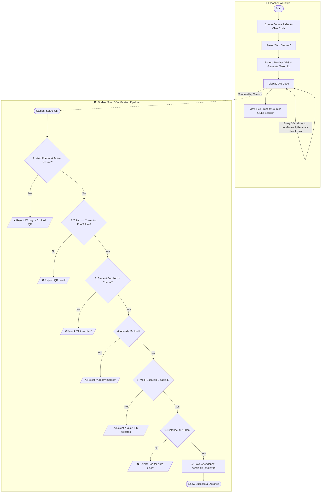
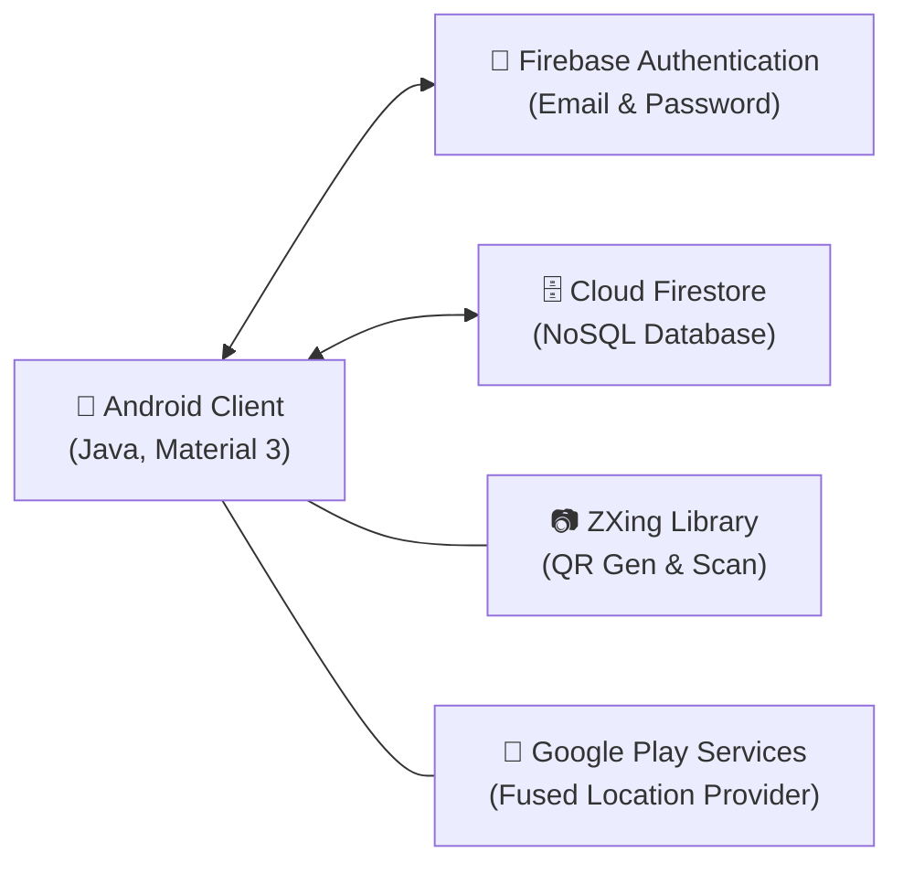
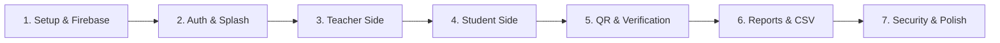

# 📱 Smart Attendance System (QR Code & Location Based)

**Project Proposal | Mobile Application Development**

---

### 📋 Project Metadata

| Attribute | Details |
| :--- | :--- |
| **Student Name** | Eman Habib |
| **Roll Number** | `242201039` |
| **Department / Semester** | BSCS 5A |
| **Instructor** | Mr. Uzair |
| **Platform** | Android (Java, Android Studio) |

---

## 📑 Table of Contents
- [1. Introduction](#-1-introduction)
- [2. Problem Statement](#-2-problem-statement)
- [3. Objectives](#-3-objectives)
- [4. Scope of the Project](#-4-scope-of-the-project)
- [5. Proposed System and Features](#-5-proposed-system-and-features)
  - [System Workflow & Verification Flowchart](#-system-workflow--verification-flowchart)
- [6. System Design](#-6-system-design)
- [7. Requirements](#-7-requirements)
- [8. Development Methodology](#-8-development-methodology)
- [9. Testing Plan](#-9-testing-plan)
- [10. Expected Outcomes](#-11-expected-outcomes)
- [11. Limitations and Future Work](#-11-limitations-and-future-work)
- [12. Conclusion](#-13-conclusion)
- [References](#-references)
- [Appendices](#-appendices)

---

## 📖 1. Introduction

Attendance is a basic requirement in every educational institution, yet most classes still record it by calling names or passing around a sheet. This takes up lecture time, is easy to misuse (proxy attendance), and produces paper records that are hard to analyse later.

This project proposes **Smart Attendance System**, an Android application that lets a teacher start a class session and display a QR code, while students mark their own attendance by scanning it with their phones. To make sure the student is actually present in the classroom, the app also verifies the student's GPS location against the location of the teacher. Attendance records are stored in the cloud and can be viewed instantly as reports.

---

## ⚠️ 2. Problem Statement

Traditional attendance methods have several problems:
- ⏱️ Roll calls waste **5 to 10 minutes** of every lecture.
- 🕵️ **Proxy attendance** is common, as a friend can mark attendance for an absent student.
- 📄 Paper registers can be lost, damaged, or entered incorrectly.
- 📉 Teachers cannot easily calculate attendance percentages or identify students with low attendance.
- 🚫 Students have no way to track their own attendance during the semester.

> A simple, secure, and low-cost digital solution is needed that works on the smartphones students already own and does not require any extra hardware.

---

## 🎯 3. Objectives

1. To develop an Android application for taking class attendance using QR codes.
2. To prevent proxy attendance through a time-limited QR code and GPS-based location verification.
3. To give teachers a quick way to manage courses, run sessions, and view attendance reports.
4. To give students a clear view of their attendance percentage in each course, with a warning when it falls below **75%**.
5. To store all data securely in the cloud using Firebase.

---

## 🔭 4. Scope of the Project

| ✅ Included | ❌ Not Included (Possible Future Work) |
| :--- | :--- |
| Two user roles: **Teacher** and **Student** | iOS version or web dashboard |
| Email and password registration and login | Face recognition or biometric verification |
| Course creation by teachers and enrolment by students using a course code | Integration with the university's student information system |
| Attendance sessions with a QR code that refreshes automatically | |
| Location verification within a fixed radius (**100 metres**) | |
| Fake GPS (mock location) detection | |
| Duplicate attendance prevention | |
| Attendance percentage for students and a per-course report for teachers | |
| Report sharing as a **CSV file** | |

---

## ⚙️ 5. Proposed System and Features

### 5.1 How the System Works
1. The teacher creates a course. The app generates a unique **6-character course code**.
2. Students join the course by entering this code.
3. When the class starts, the teacher presses **Start session**. The app records the teacher's GPS location and shows a QR code.
4. The QR code contains the `sessionId` and a random **12-character token**. The token changes every **30 seconds**, so a screenshot shared with an absent friend quickly becomes useless.
5. The student opens **Scan QR** and scans the code from the teacher's screen.
6. The app runs a series of checks (see below). If all pass, attendance is saved in the database.
7. The teacher sees a live count of present students and ends the session when the class is over.

### 🔄 System Workflow & Verification Flowchart

### 5.2 Verification Checks Performed on Each Scan

| Check | Purpose |
| :--- | :--- |
| **QR is valid and the session is active** | Rejects wrong or expired QR codes |
| **Token matches the current (or immediately previous) token** | Rejects old screenshots |
| **Student is enrolled in the course** | Only registered students can mark attendance |
| **Attendance is not already marked** | Prevents duplicate entries |
| **Mock location is not in use** | Detects fake GPS applications |
| **Student is within 100 metres of the teacher** | Confirms physical presence in class |

### 5.3 Main Features

#### 👨‍🏫 Teacher
- Create and list courses, with a shareable join code
- Start and end attendance sessions with a live present counter
- Per-student report showing classes attended, total classes, and percentage
- Share the report as CSV through WhatsApp, email, or Google Drive

#### 🎓 Student
- Join courses using a code
- Scan QR to mark attendance, with clear success or failure messages
- Overall attendance and per-course percentage, colour-coded (**green**, **amber**, **red**)
- Low attendance warning when the percentage drops below **75%**

#### 🌐 Common
- Auto-login on app start (splash screen)
- Modern Material Design 3 interface with the app logo

---

## 🏗️ 6. System Design

### 6.1 Architecture
The application follows a **client-server model**. The Android app is the client, and Firebase provides the backend services, so no separate server needs to be built or maintained.

| Layer | Technology |
| :--- | :--- |
| **Client application** | Android (Java), Material Components |
| **Authentication** | Firebase Authentication (email and password) |
| **Database** | Cloud Firestore (NoSQL) |
| **QR generation and scanning** | ZXing Android Embedded library |
| **Location** | Google Play Services, Fused Location Provider |

### 6.2 Screens (Activities)
1. **Splash screen** with auto-login and role check
2. **Login**
3. **Register** (with Student or Teacher selection)
4. **Teacher Dashboard**
5. **QR Session screen**
6. **Attendance Report**
7. **Student Dashboard**
8. **QR Scan and verification screen**

### 6.3 Database Design (Cloud Firestore)

| Collection | Main Fields |
| :--- | :--- |
| `users` | `name`, `email`, `role` |
| `courses` | `name`, `code`, `teacherId`, `teacherName`, `studentIds`, `studentNames` |
| `sessions` | `courseId`, `teacherId`, `lat`, `lng`, `startTime`, `endTime`, `active`, `token`, `prevToken` |
| `attendance` | `sessionId`, `courseId`, `studentId`, `timestamp`, `distance` |

> **Note:** The attendance document ID is formed as `sessionId_studentId`, which guarantees that a student can be recorded only once per session.

---

## 📋 7. Requirements

### 7.1 Functional Requirements
- **FR1:** The system shall allow users to register and log in as a Teacher or Student.
- **FR2:** A teacher shall be able to create courses and receive a unique join code.
- **FR3:** A student shall be able to enrol in a course using its code.
- **FR4:** A teacher shall be able to start and end an attendance session.
- **FR5:** The system shall generate a QR code that refreshes every 30 seconds.
- **FR6:** The system shall verify QR validity, enrolment, duplicate attempts, mock location, and distance before saving attendance.
- **FR7:** A student shall be able to view attendance percentage for each course.
- **FR8:** A teacher shall be able to view and share an attendance report.

### 7.2 Non-Functional Requirements
- **Security:** Firestore security rules restrict who can read and write each collection. Only teachers can create courses and sessions, and students can only write their own attendance.
- **Usability:** Simple, clean interface with clear feedback messages.
- **Performance:** Attendance should be recorded within a few seconds of scanning.
- **Compatibility:** Runs on Android 7.0 (API 24) and above.
- **Reliability:** Cloud storage ensures records are not lost if a phone is lost or reset.

### 7.3 Hardware and Software Requirements

| Item | Requirement |
| :--- | :--- |
| **Development tool** | Android Studio |
| **Language** | Java, XML |
| **Backend** | Firebase (Authentication, Firestore) |
| **Test devices** | Two Android phones with camera, GPS, and internet |
| **Minimum Android version** | 7.0 (API 24) |

---

## 🔄 8. Development Methodology

The project will follow an **incremental development model**. The app is built in small working parts, and each part is tested before the next one is started:

1. Project setup and Firebase integration
2. Authentication (register, login, splash)
3. Teacher side (courses, QR session)
4. Student side (enrolment, dashboard)
5. QR scanning and verification logic
6. Reports and CSV export
7. Security rules, testing, and final polish

---

## 🧪 9. Testing Plan

| Test | Expected Result |
| :--- | :--- |
| Register and login as Teacher and Student | Correct dashboard opens for each role |
| Student scans a valid QR inside the class | Attendance marked |
| Student scans the same session again | `"Already marked"` message |
| Scan a screenshot older than about 60 seconds | `"QR is old"` message |
| Scan from more than 100 metres away | `"Too far from class"` message |
| Scan with a mock location app enabled | `"Fake GPS detected"` message |
| Unenrolled student scans | `"Not enrolled"` message |
| Teacher opens report after session ends | Correct counts and percentages |

---

---

## 🏆 10. Expected Outcomes

- A working Android application that records attendance in under a minute for an entire class.
- Significant reduction in proxy attendance through rotating QR codes and location checks.
- Accurate, instantly available attendance reports for teachers.
- Better awareness for students about their own attendance.

---

## 🚧 11. Limitations and Future Work

- The system needs an internet connection and GPS on both devices.
- GPS accuracy can drop inside large buildings, so the distance limit may need adjusting.
- Future versions can add face verification, offline support, push notifications for low attendance, PDF reports, an admin role, and a web dashboard.

---

## 🏁 12. Conclusion

Smart Attendance System replaces slow and unreliable manual attendance with a fast, secure, and easy-to-use mobile solution. By combining rotating QR codes, GPS verification, and cloud storage, it addresses the real problems of proxy attendance and record keeping, while staying simple enough to be built with standard Android tools and Firebase.

---

## 📚 References

1. Android Developers Documentation, [developer.android.com](https://developer.android.com)
2. Firebase Documentation (Authentication and Cloud Firestore), [firebase.google.com/docs](https://firebase.google.com/docs)
3. ZXing Android Embedded library, [github.com/journeyapps/zxing-android-embedded](https://github.com/journeyapps/zxing-android-embedded)
4. Material Design 3 Guidelines, [m3.material.io](https://m3.material.io)
5. Google Play Services Location API, [developers.google.com/android/reference](https://developers.google.com/android/reference)

---

## 📎 Appendices

<b>Appendix A: Review of Existing Attendance Methods</b>

 

Before choosing the proposed approach, common attendance methods were compared on the points that matter most in a university classroom.

| Method | Speed | Proxy Prevention | Extra Cost | Record Keeping | Main Drawback |
| :--- | :--- | :--- | :--- | :--- | :--- |
| **Manual roll call** | Slow (5 to 10 min per class) | Weak | None | Paper registers | Wastes lecture time, errors, lost sheets |
| **RFID or ID card swipe** | Medium | Weak (cards can be swapped) | Readers and cards needed | Digital | Hardware cost and maintenance |
| **Fingerprint or biometric** | Medium (queues form) | Strong | Expensive devices | Digital | Cost, hygiene concerns, queues |
| **Static QR code on the wall** | Fast | Weak (photo can be shared) | None | Digital | Anyone can scan from anywhere |
| **Proposed: rotating QR plus GPS** | **Fast (under a minute for the whole class)** | **Strong** | **None (student phones only)** | **Cloud, instant reports** | **Needs internet and GPS** |

The proposed system keeps the speed and zero hardware cost of QR attendance, and fixes its main weakness (sharing the code) by combining a rotating token with location verification.

<b>Appendix B: Detailed Use Cases</b>

 

- **UC1: Register and log in**
  - **Actor:** Teacher or Student
  - **Precondition:** The app is installed and the device has internet access.
  - **Main flow:** The user opens the app, taps Sign up, enters name, email, and password, and selects a role. The system creates the account, saves the profile (including role) in the database, and opens the matching dashboard.
  - **Alternate flows:** Invalid email or a password shorter than 6 characters shows an inline error. An email that is already registered shows an error message. On later launches, the splash screen checks the saved login and opens the dashboard directly.
  - **Postcondition:** The user is signed in and sees the dashboard for their role.

- **UC2: Create a course (Teacher)**
  - **Precondition:** The teacher is logged in.
  - **Main flow:** The teacher taps New course and enters the course name. The system generates a unique 6-character course code and saves the course. The course appears on the dashboard with its code.
  - **Postcondition:** The course exists and its code can be shared with students.

- **UC3: Join a course (Student)**
  - **Precondition:** The student is logged in and has the course code.
  - **Main flow:** The student taps Join course and enters the code. The system finds the course and adds the student to it.
  - **Alternate flow:** If the code does not exist, the system shows `"This code is wrong"`.
  - **Postcondition:** The course appears in the student's list.

- **UC4: Start an attendance session (Teacher)**
  - **Precondition:** The teacher has at least one course and has allowed location permission.
  - **Main flow:** The teacher taps Start session on a course. The system reads the teacher's current GPS position, creates a session with that position, generates a random token, and shows the QR code. A 30-second countdown runs and the QR refreshes automatically. A live counter shows how many students are present. The teacher taps End session when class is over.
  - **Alternate flows:** If GPS is off or permission is denied, the session is not started. If the teacher leaves the screen without ending the session, the session is closed automatically so that an old QR cannot be reused.
  - **Postcondition:** The session is marked inactive and no further attendance can be recorded for it.

- **UC5: Mark attendance (Student)**
  - **Precondition:** The student is enrolled in the course and a session is active.
  - **Main flow:** The student taps Scan QR and allows camera and location permissions. The student scans the teacher's QR. The system runs the verification checks in order (see Appendix C.3). If every check passes, attendance is saved and a success message with the distance from the class is shown.
  - **Alternate flows:** Each failed check stops the process and shows a specific message: not an attendance QR, session ended, QR is old, not enrolled, already marked, fake GPS detected, or too far from class.
  - **Postcondition:** One attendance record exists for this student and session.

- **UC6: View attendance (Teacher and Student)**
  - **Student:** The dashboard shows overall attendance and each course's percentage, colour-coded, with a Low attendance note below 75%.
  - **Teacher:** The Report screen lists every enrolled student with classes attended, total classes, and percentage, and can share the data as a CSV file.

<b>Appendix C: Algorithms</b>

 

#### C.1 Rotating QR Token
The QR code contains the text `sessionId token`. The token is 12 random characters chosen from a set of 32 symbols (capital letters and digits, leaving out easily confused characters such as `I`, `O`, `0`, and `1`), which gives about $32^{12}$ possible values, so a valid token cannot be guessed.
1. When the session starts, generate token `T1` and save it in the session document.
2. Every 30 seconds, move the current token to a `prevToken` field, generate a new token, and update the QR image.
3. A scanned token is accepted only if it equals the current token or the previous token. The previous token is also accepted so that a student who scanned just before a refresh is not rejected unfairly.
4. Therefore a screenshot becomes useless after about 30 to 60 seconds.

#### C.2 Distance Verification
The distance between the student's position (latitude $\phi_2$, longitude $\lambda_2$) and the teacher's session position ($\phi_1$, $\lambda_1$) is calculated with the haversine formula, which is built into Android's `Location.distanceBetween()`:

$$a = \sin^2(\Delta\phi / 2) + \cos\phi_1 \times \cos\phi_2 \times \sin^2(\Delta\lambda / 2)$$

$$d = 2R \times \text{atan2}(\sqrt{a}, \sqrt{1 - a}), \quad \text{where } R = 6,371,000 \text{ metres}$$

Attendance is allowed only if $d$ is 100 metres or less. The radius is kept as a constant so it can be changed easily after field testing.

#### C.3 Attendance Verification Procedure
When a QR code is scanned, the checks are run in this order, and the process stops at the first failure:
1. The QR text has the format `sessionId token`.
2. The session exists and is active.
3. The token matches the current or previous token.
4. The student is in the course's student list.
5. No attendance record already exists with the ID `sessionId_studentId`.
6. The location is not reported as mock (`isMock()` on Android 12 and above, `isFromMockProvider()` on older versions).
7. The distance from the teacher is at most 100 metres.
8. The attendance record is saved with timestamp and distance.

> Ordering the cheap checks first (format, session, token) avoids unnecessary location requests, and putting the duplicate check before the location check saves time and battery.

#### C.4 Attendance Percentage
- $\text{Percentage} = (\text{sessions attended} / \text{total sessions held for the course}) \times 100$
- **Colour coding:**
  - 🟢 **75% and above:** Green (good)
  - 🟡 **60% to 74%:** Amber (warning)
  - 🔴 **Below 60%:** Red (danger)
- A course with no sessions yet shows `"No classes"` instead of `0%`.

<b>Appendix D: Data Dictionary</b>

 

#### Collection: `users`
| Field | Type | Description |
| :--- | :--- | :--- |
| `(document ID)` | String | Firebase Authentication user ID |
| `name` | String | Full name |
| `email` | String | Login email |
| `role` | String | `teacher` or `student` |

#### Collection: `courses`
| Field | Type | Description |
| :--- | :--- | :--- |
| `name` | String | Course title |
| `code` | String | 6-character join code |
| `teacherId` | String | User ID of the teacher |
| `teacherName` | String | Teacher's name, shown to students |
| `studentIds` | Array of String | IDs of enrolled students |
| `studentNames` | Map | Student ID to student name, used in reports |
| `createdAt` | Number | Creation time in milliseconds |

#### Collection: `sessions`
| Field | Type | Description |
| :--- | :--- | :--- |
| `courseId`, `courseName` | String | Course this session belongs to |
| `teacherId` | String | Teacher who started the session |
| `lat`, `lng` | Number | Teacher's GPS position at session start |
| `startTime`, `endTime` | Number | Session start and end time in milliseconds |
| `active` | Boolean | True while attendance is open |
| `token`, `prevToken` | String | Current and previous QR tokens |

#### Collection: `attendance`
| Field | Type | Description |
| :--- | :--- | :--- |
| `(document ID)` | String | `sessionId_studentId`, which makes duplicates impossible |
| `sessionId`, `courseId` | String | Session and course of this record |
| `studentId` | String | Student who attended |
| `timestamp` | Number | Time of marking in milliseconds |
| `distance` | Number | Student's distance from the teacher in metres |

<b>Appendix E: Security Design</b>

 

| Possible Misuse | Countermeasure in the System |
| :--- | :--- |
| Student sends a QR screenshot to an absent friend | Token changes every 30 seconds and old tokens are rejected |
| Absent student scans a live QR shown on a video call | GPS must be within 100 metres of the teacher's position |
| Student uses a fake GPS app | Mock location flag from the operating system is checked and rejected |
| Student marks attendance twice | Record ID is fixed as `sessionId_studentId`, and database rules disallow updates |
| Student not in the course tries to scan | Enrolment is checked before saving |
| Student pretends to be a teacher to create sessions | Database rules allow only users with the teacher role to create courses and sessions |
| Someone edits another user's attendance | Database rules allow a student to create only their own record, and nobody can edit or delete records from the app |
| Unauthorised access to data | All reads require a signed-in user; passwords are handled by Firebase Authentication and are never stored by the app |

**Android permissions used:** Internet (cloud access), Camera (QR scanning), Fine and Coarse Location (distance verification). Camera and location are requested at the moment they are needed, and the app explains clearly if the user refuses.

<b>Appendix F: User Interface Description</b>

 

The interface follows **Material Design 3** with rounded cards and buttons, a soft grey background, and a violet-blue primary colour, so that the app looks modern and consistent.

| Screen | Contents |
| :--- | :--- |
| **Splash** | Logo, app name, tagline; checks saved login and role |
| **Login** | Logo, email and password fields with icons, Login button, link to Sign up |
| **Register** | Student or Teacher toggle, name, email, password, Register button |
| **Teacher Dashboard** | Greeting, list of course cards (name, join code, Start session and Report buttons), New course button, Logout |
| **QR Session** | Course name, large QR code, 30-second countdown, live present counter, End session button |
| **Report** | Course name, number of classes and students, list of students with attended count and coloured percentage, Share as CSV button |
| **Student Dashboard** | Greeting, overall attendance card, course cards with coloured percentage, Join course, Scan QR button, Logout |
| **Scan and Result** | Camera scanner, then a clear success or error result with an explanation and a back button |

<b>Appendix G: Feasibility Study</b>

 

- **Technical:** All required components (Android SDK, Firebase, ZXing, Fused Location Provider) are mature, well documented, and free to use at student-project scale. No server development is needed.
- **Economic:** Development tools are free. Firebase's free plan is sufficient for a class or department-sized deployment. There is no hardware cost because students already own smartphones.
- **Operational:** The workflow is short (open app, scan, done) and does not require training. Teachers need only to show the QR on a phone or on a projector.
- **Schedule:** The work is divided into small modules that fit within the 7-week plan, and each module can be tested independently.

<b>Appendix H: Risk Analysis</b>

 

| Risk | Likelihood | Impact | Mitigation |
| :--- | :---: | :--- | :--- |
| **Poor GPS accuracy indoors** | Medium | Students wrongly rejected | Request high-accuracy location, keep the radius adjustable, test inside real classrooms |
| **No internet in class** | Medium | Attendance cannot be saved | Use mobile data as a fallback; offline support listed as future work |
| **Student denies camera or location permission** | Low | Cannot mark attendance | Clear messages explaining why each permission is needed |
| **Teacher accidentally closes the session screen** | Low | Session ends early | Session is closed cleanly and a new one can be started |
| **Firebase free-plan limits reached** | Low | Service slowdown | Usage in a single department is far below the limits |
| **Schedule delay** | Medium | Features incomplete | Incremental plan, core attendance flow built first, extras only if time remains |

<b>Appendix I: Glossary</b>

 

| Term | Meaning |
| :--- | :--- |
| **QR code** | A two-dimensional barcode that can be read by a phone camera |
| **Token** | A random string embedded in the QR code that proves it is current |
| **GPS** | Global Positioning System, used to find the phone's location |
| **Geofence** | A virtual boundary (here, 100 metres) around the teacher's position |
| **Mock location** | A fake GPS position provided by a spoofing app |
| **Firebase** | Google's cloud platform used here for login and database |
| **Firestore** | Firebase's NoSQL cloud database that stores data as collections and documents |
| **Proxy attendance** | Marking attendance on behalf of an absent student |
| **Activity** | One screen of an Android application |

